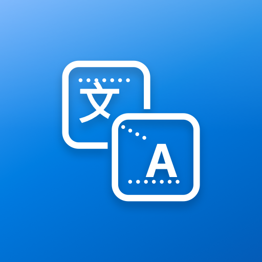
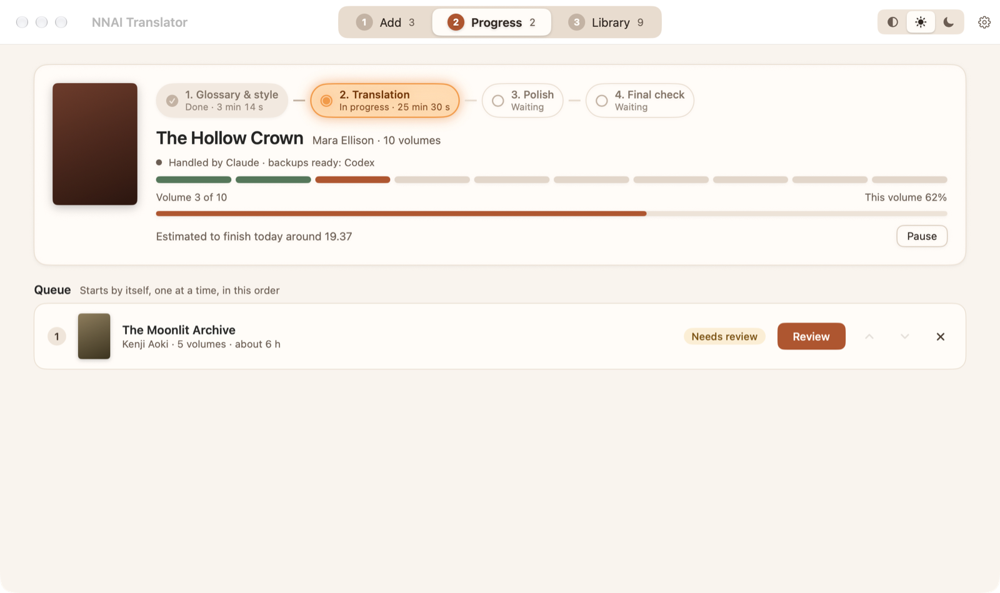
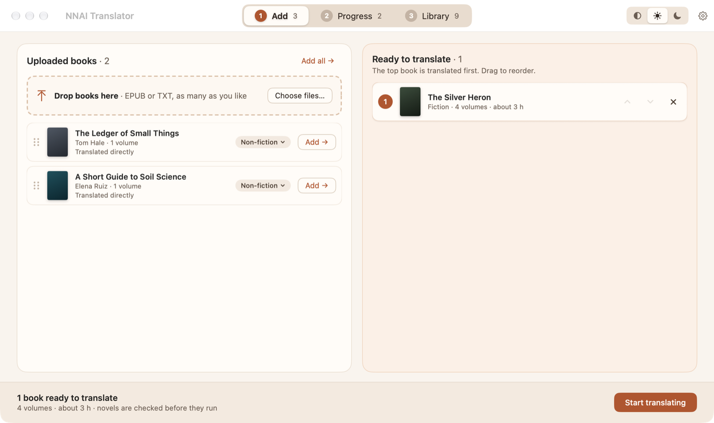
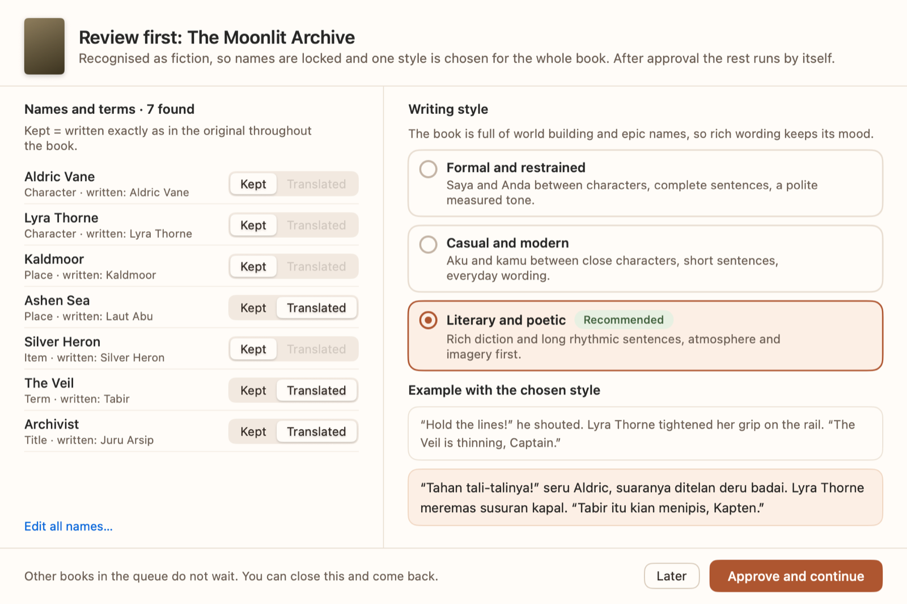
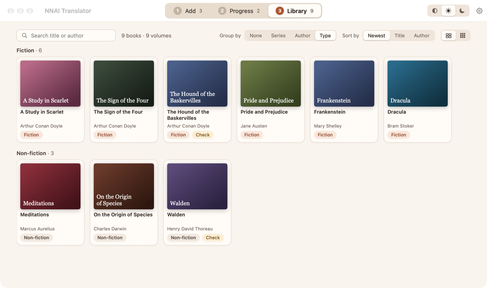

  
  <h1>NNAI Translator</h1>
  
Read whole books in the language you understand, using the AI tools you already have.

NNAI Translator is a Mac app that translates EPUB and TXT books with the command-line AI tools that are
already signed in on your Mac: **Claude**, **Codex** and **Antigravity**. Add your books, put them in
order, and they are translated one after another while you do something else.

  

## What it does

- **Queue.** Add many books at once, drag them into the order you want, pause and resume any time, even
  after closing the app. You see each stage (glossary, translation, polish, final check) and the time it took.
- **Your pace.** Switch off the polish pass for novels, or send up to three requests at once, to finish
  sooner.
- **Consistent names.** For fiction the app first builds a glossary of characters, places and terms, so
  names are written the same way from the first page to the last, and it suggests a writing style that
  fits the book. Multi-volume novels are split and translated volume by volume.
- **Sturdy.** If one AI tool runs out of quota or fails, the next one takes over by itself.
- **A translation log you control.** Which model translated, how fast and how cleanly, kept on your Mac to
  improve the recommendations. No book text, and nothing is sent; switch it off in Settings
  ([what it records](docs/TRANSLATION_LOG.md)).
- **A library.** Finished books appear with their covers. Check the metadata, fix a field, or look the book
  up online by its ISBN (Open Library, Google Books) before you put it in Apple Books.
- **Your Mac.** Light and dark theme, English or Indonesian menus, 18 target languages
  (Indonesian is the best tuned; the others have had less testing).

## Screenshots

The pictures show sample data.

| Add books and set their order | Check names and style before a novel starts |
| --- | --- |
|  |  |

  
   <em>The library of finished books</em>

## How it differs from the main project

The main project (see below) is a general translator: a web and desktop app
for many formats (EPUB, SRT, DOCX, PDF, TXT, PGN), with local models through Ollama or cloud providers
through an API key. NNAI Translator narrows that down to translating whole **books** on a Mac, and adds:

- **The AI tools you already use.** Claude, Codex and Antigravity through their command-line tools, with no
  API keys to manage. If one runs out of quota, the next one carries on.
- **A queue for many books**, in the order you choose, with pause and resume.
- **Names that stay the same.** Fiction gets a glossary of characters, places and terms before translating,
  and you review it, with the writing style, in one screen before the long run starts (or set the style to
  Automatic and the recommended one is used right away).
- **A style that fits the book.** A writing style is recommended from the text itself, then a polish pass
  smooths the result (you can switch it off).
- **Series.** A multi-volume file is split and translated volume by volume. Volumes added one by one, in any
  order, share their names and writing style.
- **Cleaning and checking.** Licence headers, donation appeals and download-site credits are removed
  instead of translated, and every finished book is checked against its original: missing or shortened
  pages, broken links and doubtful names are shown to you.
- **Metadata and a library.** Check and edit each book's metadata, find it online by ISBN, and browse the
  finished books with their covers.
- **A native Mac app.** Light and dark theme, menu-bar progress, and the engine built in.

What it gives up: it takes EPUB and TXT only (no subtitles, DOCX or PDF), it has no local models through
Ollama, and it runs on macOS only. Use the main project for those; use NNAI Translator for books.

## Install

1. Download `NNAI-Translator-<version>.dmg` from the [Releases](../../releases) page, open it and drag
   **NNAI Translator** to Applications.
2. On first launch the app sets up its Python libraries once (it asks first, needs the internet and
   **Python 3.10 or newer**, for example `brew install python@3.13`).
3. Make sure at least one of the `claude`, `codex` or `agy` command-line tools is installed and signed in.

The app is signed ad hoc, not notarised. If macOS refuses to open a downloaded copy, right-click the app
and choose **Open** once.

Requires macOS 14 or newer. How the app works and its known limits are in its About window. To build it yourself: `app/BookTranslator/Tools/package.sh`
(details in [app/BookTranslator/README.md](app/BookTranslator/README.md)).

## Command line

The app drives `translate_book.py`, which you can also run directly. How the pipeline works and every
option are in [docs/BOOK_AGENT.md](docs/BOOK_AGENT.md).

## Please buy the books

Translating a book with AI is a convenience, not a replacement for the people who made it. **Buy the
official edition** of the books you read, from the author, the publisher or a legitimate store, and buy the
official translation when one exists in your language. Authors, translators and publishers depend on it.

This project only helps you read a book you legitimately own in a language you understand. It is for
personal reading. It is not meant for pirated files, and you are responsible for following the copyright
law of your country; please do not share or sell the translations it produces.

## Main project

NNAI Translator is built on top of **[TBL: Translate Books with LLMs](https://github.com/hydropix/TranslateBooksWithLLMs)**
by hydropix. Its translation engine (EPUB handling, chunking, checkpoints, providers) does the heavy
lifting here. If you want the original web and desktop app, local models with Ollama, or more formats such
as subtitles, DOCX and PDF, use the main project.

## License

[GNU AGPL-3.0](LICENSE), the same as the main project.
